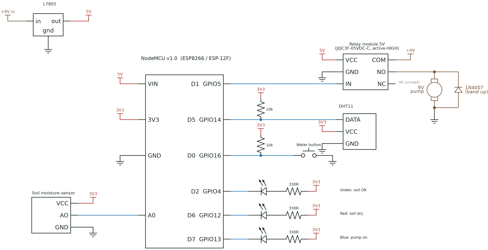

# PlantPal circuit



Vector version: [plantpal-schematic.svg](plantpal-schematic.svg). Regenerate both
after editing [schematic.py](schematic.py):

```sh
uv run --with schemdraw --with matplotlib python docs/circuit/schematic.py
```

Supply connections are drawn as **net labels**: every `3V3` symbol is the same
wire, every `5V` is the same wire, every ground symbol is the same ground.

## Parts

| Part | Qty | Notes |
|---|---|---|
| NodeMCU v1.0 (ESP8266, ESP-12F) | 1 | |
| 5 V relay module, JQC3F-05VDC-C | 1 | active-HIGH (clicks when IN = 3V3) |
| 9 V DC water pump | 1 | |
| 9 V DC supply | 1 | must supply the pump's current; a PP3 battery sags badly |
| L7805 regulator | 1 | 9 V → 5 V for NodeMCU VIN and relay VCC |
| 1N4007 diode | 1 | flyback across the pump |
| DHT11 | 1 | |
| Soil moisture sensor (analog AO) | 1 | |
| Push button | 1 | |
| LEDs: green, red, blue | 3 | |
| 330 Ω resistors | 3 | LEDs |
| 10 kΩ resistors | 2 | DHT11 data and button pull-ups |

## Wiring table

Breadboard rails: one rail pair for **5V / GND**, the other for **3V3 / GND**.
Bridge the two GND rails.

| From | To | Wire |
|---|---|---|
| 9 V supply + | L7805 **in** (left pin, text facing you) and relay **COM** | power |
| 9 V supply − | GND rail | |
| L7805 **gnd** (middle) | GND rail | |
| L7805 **out** (right) | 5V rail | |
| 5V rail | NodeMCU **VIN**, relay **VCC** | |
| NodeMCU **3V3** | 3V3 rail | |
| NodeMCU **GND** | GND rail | |
| NodeMCU **D1** | relay **IN** | signal |
| relay **NO** | pump **+** | pump |
| pump **−** | GND rail | |
| 1N4007 | across the pump: **band to pump +**, other end to pump − | |
| NodeMCU **D5** | DHT11 **DATA**; 10 kΩ from DATA to 3V3 | |
| DHT11 VCC / GND | 3V3 rail / GND rail | |
| NodeMCU **A0** | moisture sensor **AO** | |
| Moisture VCC / GND | 3V3 rail / GND rail | |
| NodeMCU **D0** | one button leg; 10 kΩ from D0 to 3V3 | |
| other button leg | GND rail | |
| NodeMCU **D2 / D6 / D7** | green / red / blue LED **cathode** (short leg) | |
| each LED **anode** (long leg) | 330 Ω → 3V3 rail | |

LEDs are wired **active-low**: the pin goes LOW to light them. That's why the
anode goes to 3V3, not to ground.

## Build order (test as you go)

1. **Power only.** 9 V in, L7805, rails. Measure 5V rail ≈ 5.0 V before plugging
   anything else in.
2. **NodeMCU.** VIN, GND, 3V3. Board boots on 9 V without USB.
3. **LEDs.** Green or red lights within a few seconds of boot.
4. **Button.** Pressing it lights blue (pump cycle) for ~3 s.
5. **Sensors.** DHT11 and moisture; values show on the dashboard.
6. **Relay, no pump.** Button press → relay clicks, its LED lights for ~3 s.
7. **Pump + diode last.** Check the diode band faces pump +, then connect.

## Gotchas

- **Common ground.** 9 V supply, regulator, NodeMCU, relay and sensors all share
  one ground. Missing it is the #1 cause of a relay that won't switch.
- **Don't power VIN from 3.3 V** (the old LM2596 output). VIN needs 5 V.
- **L7805 gets warm** (about 4 V × 0.25 A ≈ 1 W). Normal; keep it clear of
  the plastic.
- **Pump on NO, not NC.** On NC the pump runs whenever the relay is off,
  including at boot.
- **DHT11 module with 3 pins** already has the pull-up; skip the 10 kΩ.
- **D1 (GPIO5)** was chosen because it stays LOW during boot, so the pump
  can't twitch at power-up. Don't move the relay to D3, D4 or D8.
- If you have them, 0.33 µF on the L7805 input and 0.1 µF on its output
  steady the 5 V rail. Not required for a demo.
